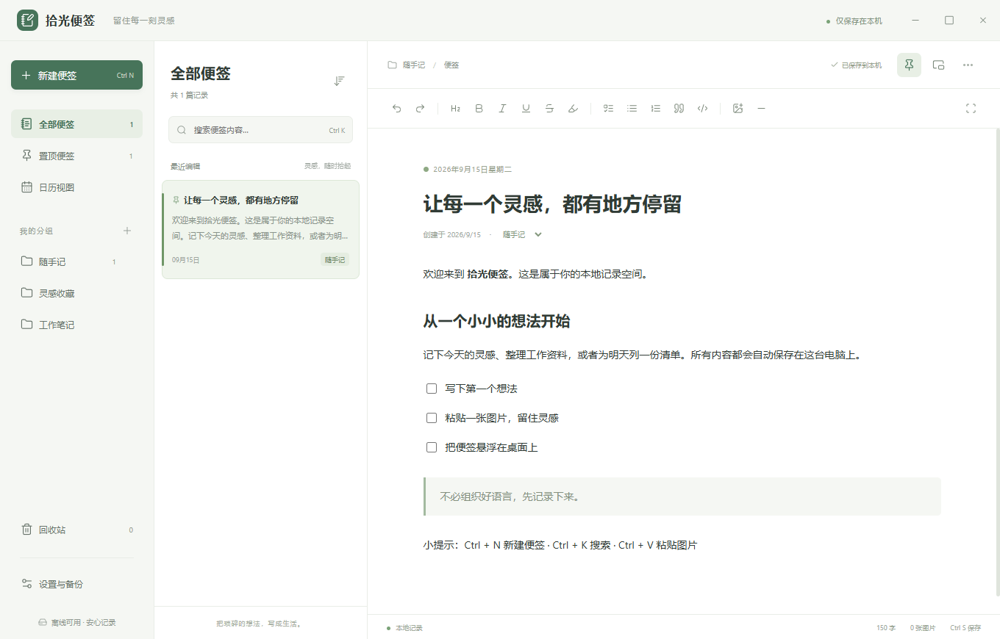

# 拾光便签

**简体中文** | [English](README.en.md)

参考 WPS 便签三栏工作方式开发的独立 Windows 本地便签。支持离线运行，无需账号。



## 启动

从源码构建后，打开 `release/win-unpacked/拾光便签.exe`。源码仓库不包含预编译程序，构建步骤见下方“开发”。

程序为免安装版本。移动到其他电脑时，请复制整个 `release/win-unpacked` 文件夹，不能只复制 exe。建议使用 Windows 10 / 11 64 位。

## 平台与体积

本版仅在 Windows x64 上打包和测试，界面语言为简体中文。Electron 支持跨平台开发，但 macOS 与 Linux 版本尚未适配和验证。中英文说明文档不代表应用已提供英文界面。

当前 Windows 免安装目录约 304 MB，主要来自 Electron 自带的 Chromium 和 Node.js。源码仓库不包含开发依赖、打包产物或用户便签数据。便签数据量取决于保存的文字、图片与备份数量。

## 已实现

- 全部便签、置顶、分组、按编辑日期筛选的月历、回收站。
- 标题与正文搜索，按编辑时间、创建时间、标题排序。
- 富文本：标题、粗体、斜体、下划线、删除线、高亮、引用、代码块、列表、待办清单。
- 本地图片选择、截图粘贴、图片拖入；支持 PNG / JPEG / GIF / WebP，单张上限 15 MB。
- 400 毫秒延迟自动保存，切换便签与关闭窗口前保存。
- 便签置顶、桌面悬浮窗口、悬浮与主窗口内容同步。
- 复制全部文字、创建副本、导出 TXT / 图文 HTML。
- 完整 JSON 备份导入导出，导入追加为新便签，不覆盖当前内容。
- 浅色 / 深色主题、专注模式、系统托盘、全局新建快捷键。

## 快捷键

| 快捷键 | 功能 |
| --- | --- |
| Ctrl + N | 新建便签 |
| Ctrl + K | 搜索 |
| Ctrl + S | 立即保存 |
| Ctrl + B / I / U | 粗体 / 斜体 / 下划线 |
| Ctrl + Z / Ctrl + Shift + Z | 撤销 / 重做 |
| Ctrl + V | 粘贴文字或剪贴板图片 |
| Ctrl + Alt + N | 在其他程序中快速新建便签 |
| Esc | 退出专注模式 |

关闭主窗口会隐藏到托盘；右键系统托盘图标，选择“退出”可完全关闭。悬浮便签的关闭按钮仅关闭该悬浮窗口。全局快捷键在程序运行时有效；若已被其他程序占用，可使用托盘“新建便签”。

## 数据与备份

在“设置与备份 → 打开目录”查看真实数据位置。默认在 `%APPDATA%/拾光便签/data`（源码开发模式可能为 `%APPDATA%/shiguang-notes/data`）。

- `notes.json` 保存正文和内嵌图片；不会上传云端。
- 有内容修改时，最多每 15 分钟生成一份 `backup-*.json`，保留最近 30 份。
- 导入前也生成备份。导入同一份文件多次会生成多份便签副本。
- 写入采用临时文件、刷新磁盘、同目录替换；主文件损坏时尝试读取最近的有效备份，保留 `damaged-*.json` 原文件。
- 自动备份与原数据在同一磁盘。需要迁移或防止磁盘损坏时，请使用“导出备份”保存到其他位置。
- 数据以可读 JSON 保存，未加密。

## 与 WPS 的关系

这是独立程序，不依赖 WPS，不读取或修改 WPS 数据。本版不含 WPS 账号同步、WPS 私有格式导入、提醒通知或开机自启。可从 WPS 复制文字与图片到便签；外部网页图片地址不会自动下载，需要复制图片本身或插入本地图片。

## 开发

需要 Windows 10 / 11、Node.js 22 或更高版本及 npm：

```sh
npm ci
npm run build
npm start
npm test
npm run test:ui
npm run pack
```

依赖版本锁定在 `package-lock.json`。`npm run pack` 会生成图标、构建界面并输出 Windows 免安装目录。测试使用独立临时数据目录；`npm start` 会打开开发模式的便签数据。首次安装依赖需要网络。

源码：`src/main.cjs` 为桌面主进程，`src/store.cjs` 为数据存储，`src/preload.cjs` 为隔离通信，`src/renderer.js` 为界面逻辑，`src/style.css` 为样式。

技术组件：[Electron](https://www.electronjs.org/)、[Tiptap](https://tiptap.dev/)、[Lucide](https://lucide.dev/)。编辑器使用本地打包资源。桌面运行时采用进程沙盒和上下文隔离。

## 验证

`tests/store.test.cjs` 覆盖持久保存、回收恢复、删除分组保留内容、损坏恢复、追加导入、非法数据拒绝。

`tests/ui.cjs` 使用真实 Electron 窗口验收中文编辑、待办、图片、搜索、分组、悬浮同步、回收恢复、主题、日历、关闭保存与重启持久化。测试使用独立临时数据目录，不写入正常使用数据。截图保存到 `test-results`。

## 许可

项目自有源码采用 MIT 许可。第三方组件沿用各自许可，参见打包目录中的 Electron 许可文件和 `THIRD_PARTY_NOTICES.md`。

欢迎通过 GitHub Issues 反馈问题，或提交 Pull Request。报告问题时，请提供系统版本、复现步骤和已脱敏的截图，不要上传个人便签或完整数据备份。
